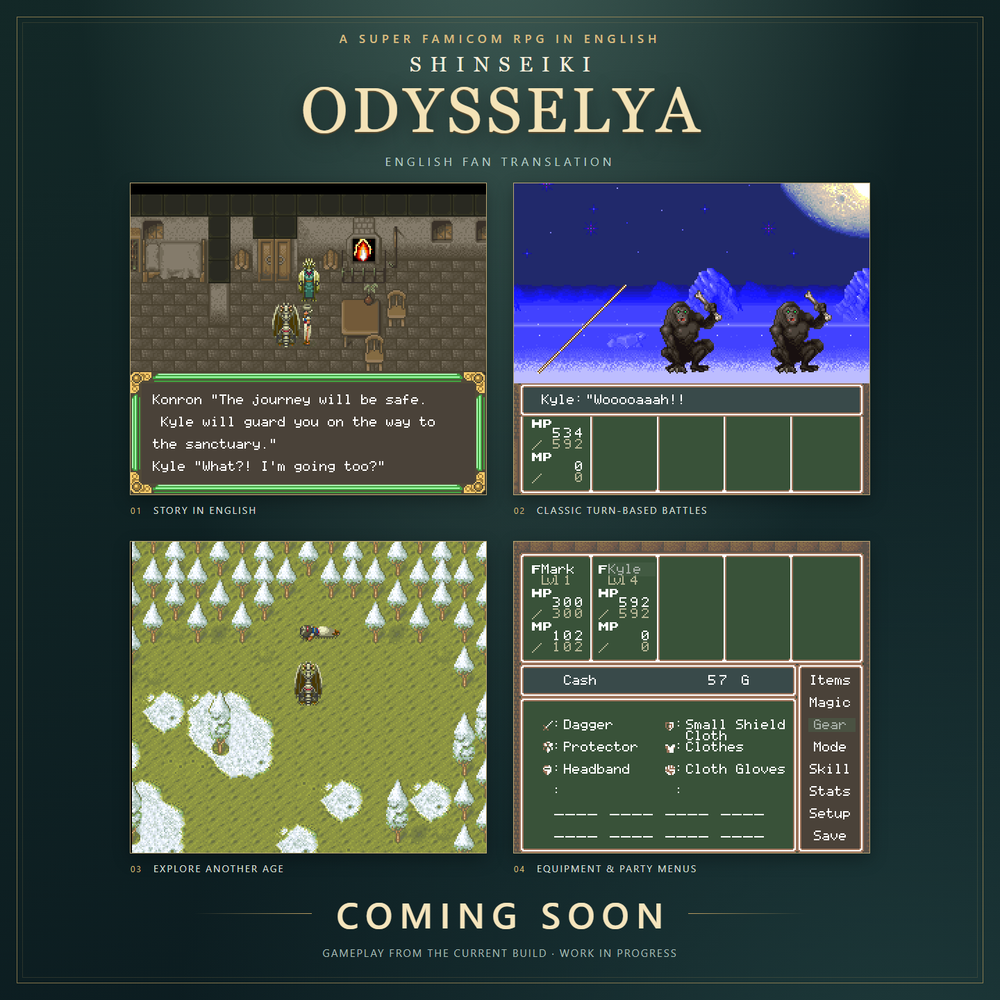

# Shinseiki Odysselya — English Fan Translation



An English fan translation of **Shinseiki Odysselya**, the 1993 Super Famicom RPG from VIC TOKAI.

## The story

A mysterious traveler awakens in an unfamiliar world with no memory of her past. Her search for answers becomes a journey across ages, where ancient civilizations, strange creatures, and the legends of the gods are closer than they seem.

## Project status

**Coming soon — playtesting and polish are in progress.**

The screenshots show a work-in-progress build. A release date has not been announced.

This repository is for project updates and patch releases. Development tools are kept private.

## Required base ROM

The English patch requires an **unmodified, unheadered Japanese ROM** matching these details:

| Detail | Required value |
| --- | --- |
| Game | Shinseiki Odysselya (Japan) |
| Platform | Super Famicom / SNES |
| File size | 1,572,864 bytes (1.5 MiB) |
| Copier header | None |

**SHA-1:**

```text
581de180568d85e4fd6f06c800caeff0e74d43fe
```

When the patch is released, apply the **BPS patch** to a base ROM matching the hash above. ROM files are not included.

Original game © 1993 VIC TOKAI. English translation is an unofficial fan project.
