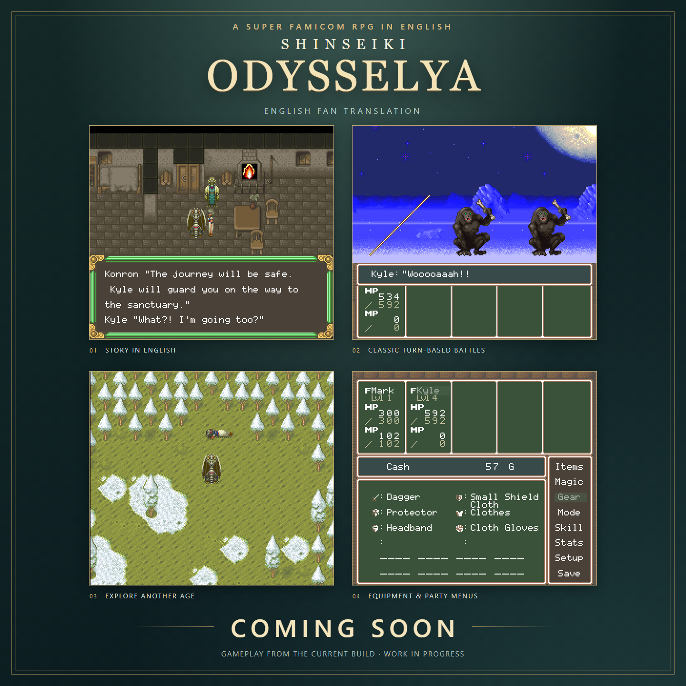

# Shinseiki Odysselya I & II — English Fan Translations

English fan translations of **Shinseiki Odysselya** and **Shinseiki Odysselya II**,
two Super Famicom RPGs from VIC TOKAI. Patches for both games will be available
from this repository’s [Releases page](../../releases).

## The story

A mysterious traveler awakens in an unfamiliar world with no memory of her past. Her search for answers becomes a journey across ages, where ancient civilizations, strange creatures, and the legends of the gods are closer than they seem.

## Project status

- **Shinseiki Odysselya** is in English v0.9 beta playtesting. The current
  checkpoint is **R17 (November 20, 2026)**. It includes the English opening,
  all 5,301 extracted dialogue entries, many translated menus, and the Assist
  menu. The screenshots show a work-in-progress build of the first game.
- **Shinseiki Odysselya II** is in development. The opening English preview is
  being tested, and the sequel patch is forthcoming.

Recent first-game fixes keep long item and weapon names inside their menus,
add English location signs such as the Kali Temple entrance, and improve
Rasetsu’s party header and the Battle Mode layout. Later chapters still need
broader playtesting, and some title, chapter, and credits graphics remain
to be translated. The project-specific development tools are private.

### Assist menu in the first game

Press **Select+B** during free movement to open **Assist**. You can turn
random encounters on or off and set battle EXP and G to **1×**, **2×**, or
**3×**. Story battles still occur. Choose **Exit** or press **B** to return to
the game. Settings last for the current play session.

## Community

Follow development and ask about playtesting on Discord. If you spot
untranslated, clipped, or overlapping text, include the build version,
location or menu, and a screenshot if you have one. [Join our Discord](https://discord.gg/DwR2jxj5b)

## Public tools & acknowledgments

This project uses [translate-retro-game](https://github.com/minhnhattonthat/translate-retro-game) by [minhnhattonthat](https://github.com/minhnhattonthat), a public toolkit and workflow for retro-game translation.

It includes ROM and text utilities, emulator-based testing, screenshot tools, and patch creation. Visit the repository to get the tools and read the setup instructions and license.

## Applying a patch

Download the **BPS patch** for your game from [Releases](../../releases) and
apply it to the matching **unmodified, unheadered Japanese ROM**.

| Super Famicom game | ROM size in bytes | SHA-1 |
| --- | ---: | --- |
| Shinseiki Odysselya (Japan) | 1,572,864 | `581de180568d85e4fd6f06c800caeff0e74d43fe` |
| Shinseiki Odysselya II (Japan) | 3,145,728 | `dcbc42a7385d25a1b35791d2a1088a8d46f873bb` |

The releases contain patches and documentation. The original games are
copyright VIC TOKAI. This is an unofficial fan project.
